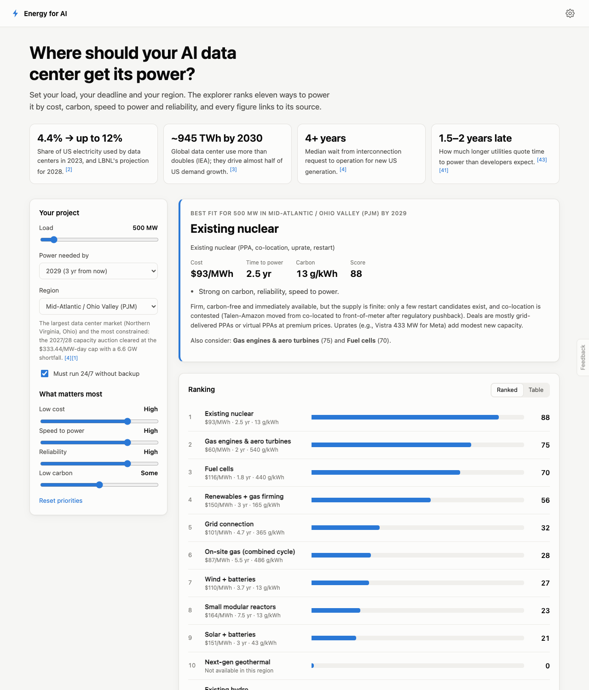
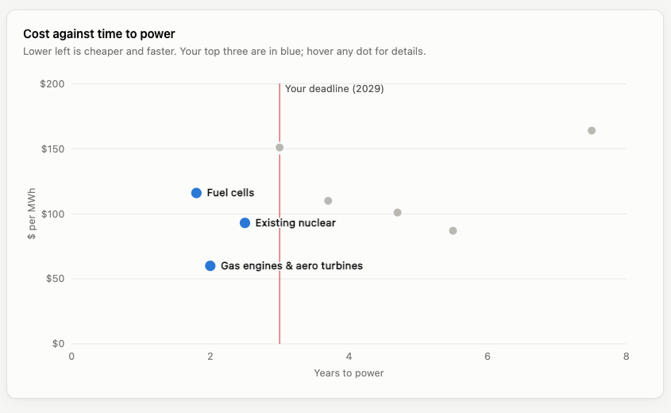
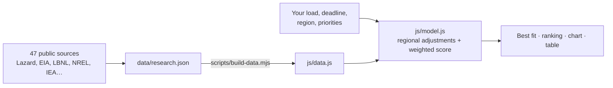

# Energy for AI

Where should an AI data center get its power? Set your load, deadline and US region, and Energy for AI ranks eleven power options by cost, carbon, speed to power and reliability. Every figure links to its source.

**[Open the explorer →](https://amalmehta.github.io/EnergyForAI/)**

## Docs

- [How to set up, run and use it](docs/INSTRUCTIONS.md)
- [System design](docs/SYSTEM-DESIGN.md)
- [What's where](docs/FILE-STRUCTURE.md)
- [Original brief](EnergyForAI.md)
