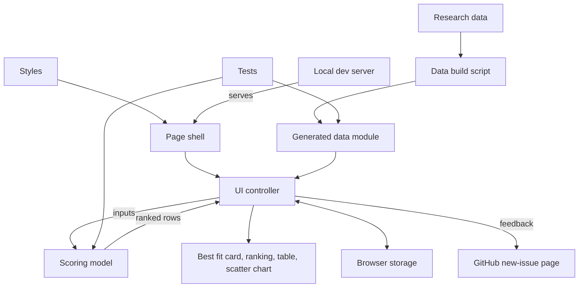
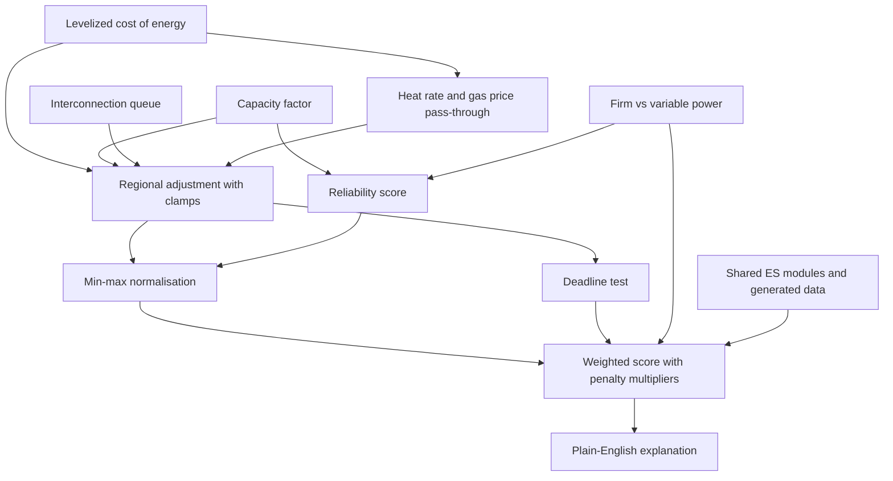

<!-- ProjectForge explainer at 8568225 -->
# How EnergyForAI was built

EnergyForAI is a static website that helps someone developing an AI data center decide where to get power. You enter a load, a deadline, a US region and your priorities, and it ranks eleven supply options, from grid connection to small modular reactors, citing a source for every figure. The core idea is a model you can see through: each option starts from cited cost and timeline ranges, regional conditions adjust it, and a weighted score that you can trace ranks the options, so a developer can see *why* each one lands where it does.

## Build history

- **2026-10-07, first release:** the whole explorer arrived in one commit: research data, scoring model, UI, tests and docs. It is an interactive explorer built for a data center developer, as a website only, following the decisions above.
- **2026-10-17, app icon:** added an app icon. The repo has `favicon.ico`, `favicon.svg` and `apple-touch-icon.png`.
- **2026-11-09, spec refresh:** brought the spec (`EnergyForAI.md`) up to the current meta doc and added the shared shortcuts file (`Shortcuts.md`).
- **2026-11-10, spec line:** added the meta doc's line about fitting how people naturally interact with the world.

## Code map

| Part | File | What it does |
|---|---|---|
| Research data | `data/research.json` | The source of truth: cited sources, 11 power options, 10 US regions and the headline context facts. Edited by hand. |
| Data build script | `scripts/build-data.mjs` | Reads the research, fills the hydro gaps, adds short display names and fact-card headlines, and writes `js/data.js`. |
| Generated data module | `js/data.js` | The research as an ES module (`export default {...}`), so the browser and Node can both import it. Never edited by hand. |
| Page shell | `index.html` | The layout and controls; loads `js/app.js` as a module. |
| Styles | `css/style.css` | Light and dark themes and the responsive layout. |
| UI controller | `js/app.js` | Reads the controls, calls the model, renders the results, and handles settings, the tooltip and feedback. |
| Scoring model | `js/model.js` | Pure functions with no DOM: `evaluateOption`, `rankOptions`, `explain`. |
| Browser storage | `localStorage` keys `efa.settings`, `efa.input`, used in `js/app.js` | Remembers theme, units and the last inputs. |
| Tests | `tests/model.test.mjs` | Checks how the model behaves and that the real data is sound, using `node --test`. |
| Local dev server | `scripts/serve.py` | Serves the folder on localhost with `Cache-Control: no-store`, so edited modules show up on reload. |

## Concepts

**Levelized cost of energy (LCOE)**: the lifetime cost of a power plant divided by the energy it makes, in $/MWh. It lets you compare plants with very different capital and fuel costs. Each option's `lcoe_usd_mwh` holds a cited low and high, and the model starts from their midpoint (`mid` in `js/model.js`). The grid has no LCOE, so its "cost" is the region's average industrial retail price (`industrial_power_price_usd_mwh`, applied in `evaluateOption`). That price leaves out demand charges and upgrade costs, as `docs/SYSTEM-DESIGN.md` notes. Lives in `data/research.json` and `js/model.js`.

**Capacity factor**: the share of a year's hours a plant actually produces at full output. Solar's is about 0.25 and nuclear's about 0.9. The project needs it twice. First, a sunnier region spreads the same solar capital over more MWh, so cost scales inversely with the regional capacity factor. Second, it feeds the reliability score. The reference values are `REF.solarCF = 0.25` and `REF.windCF = 0.35` in `js/model.js`. The per-region values are `solar_cf` and `wind_cf` in `data/research.json`.

**Firm vs variable power**: a firm source can run whenever it is needed, like gas, nuclear or the grid. A variable source follows the weather, like solar or wind. A data center runs 24/7, so the "must be firm" checkbox matters: an option that isn't firm gets a note in `evaluateOption` and a ×0.6 score penalty in `rankOptions` (`js/model.js`). The `firm` flag sits on each option in `data/research.json`.

**Heat rate and gas price pass-through**: heat rate is the fuel energy a plant burns per MWh it produces, in MMBtu/MWh. Lower means more efficient. The cited gas plant costs already assume some gas price, so the model passes through only the regional difference from a $2.50/MMBtu reference:

$$\text{cost} \mathrel{+}= (P_\text{region} - 2.5) \times \text{HR}$$

The heat rates are 6.5 for combined cycle, 9.0 for engines and aero turbines, 7.0 for fuel cells, and 2.5 for the renewables-plus-gas hybrid, where gas covers about a third of the hours (`HEAT_RATE`, `REF.gasPrice` in `js/model.js`). The test "higher gas price raises gas cost through the heat rate" checks that $2/MMBtu more gas adds exactly $13/MWh to combined cycle (`tests/model.test.mjs`).

**Interconnection queue**: the line of projects waiting for a utility to study and connect them. The national median from request to operation is 4.6 years (`REF.queueYears`). The regional medians in the research measure new *generators*, not new loads. So instead of replacing the national timeline, they only scale it by $q_\text{region}/4.6$, clamped to 0.7–1.3. This applies only to the options that wait in that queue (`QUEUE_BOUND`: grid, solar, wind, hybrid, hydro), in `js/model.js`.

**Regional adjustment with clamps**: each regional factor is a ratio, like reference capacity factor over regional capacity factor, bounded by `clamp(x, lo, hi)`. The bounds stop one odd data point from swamping the score. For example, solar cost can only move between 0.75× and 1.6×. Geothermal and hydro use a resource grade instead: `poor` makes the option unavailable, and `fair` adds 25% to cost and 1 year to the timeline (`RESOURCE_COST`, `RESOURCE_DELAY`). Projects bigger than one typical site need $\lceil \text{load}/\text{max site} \rceil$ sites, and each extra site adds 0.25 years, up to 3. All of this is in `evaluateOption`, `js/model.js`.

**Reliability score**: a single number that puts firm options above variable ones whatever their capacity factor:

$$r = \begin{cases} 0.6 + 0.4\,\text{cf} & \text{firm} \\ 0.5\,\text{cf} & \text{variable} \end{cases}$$

Grid and the gas-firmed hybrid have no capacity factor of their own. They get 0.95 if firm (0.35 otherwise). This is in `evaluateOption`, `js/model.js`.

**Deadline test**: the "needed by" year minus `CURRENT_YEAR` (2026) gives the years available. If even the fast end of the timeline (`yearsLow`) is too late, the option *misses the deadline*. If only the midpoint is too late, the timeline is *tight*. This is in `evaluateOption`, `js/model.js`.

**Min-max normalisation**: rescales each criterion to 0–1 across the options still available, so dollars, years and grams can be added together. For a criterion where lower is better:

$$p = \frac{\max - v}{\max - \min}$$

If all values are equal, every option gets 1. This is the hard part to keep in mind: scores are *relative* to the option set. Removing an unavailable option, or a region changing one option's cost, shifts every other option's score. `docs/SYSTEM-DESIGN.md` names this trade-off. Lives in `norm` inside `rankOptions`, `js/model.js`.

**Weighted score with penalty multipliers**: the four 0–1 parts (cost, carbon, speed, reliability) are averaged using the user's weights. The weights run 0–4, from "Ignore" to "Critical", in `js/app.js`. Then hard constraints multiply the result down:

$$\text{score} = 100 \cdot \frac{\sum_k w_k\,p_k}{\sum_k w_k} \times m_\text{deadline} \times m_\text{firm}$$

Here $m_\text{deadline}$ is 0.5 for a miss, 0.85 for tight, 1 otherwise, and $m_\text{firm}$ is 0.6 for an option that isn't firm when 24/7 is required. Unavailable options score 0. Using multipliers instead of exclusion keeps a slow but cheap option visible, just lower down. Lives in `rankOptions`, `js/model.js`.

**Plain-English explanation**: `explain` reads each row's normalised parts. It names a criterion as a strength if its part is ≥ 0.7 and a weakness if it is ≤ 0.3, then adds the notes `evaluateOption` collected (missed deadline, multiple sites, fair resource). This is what lets the developer see *why* an option ranks where it does. Lives in `js/model.js`.

**Shared ES modules and generated data**: `js/model.js` touches no DOM, and `js/data.js` is a plain `export default` module. So the same files run in the browser, imported by `js/app.js`, and in Node, imported by `tests/model.test.mjs`. There is no bundler and no build step for the site itself. The only build step turns the research JSON into a module, through `scripts/build-data.mjs`. That keeps the hand-edited research file separate from the display tweaks layered on top of it.

## One input, start to finish

Input: a first visit with the defaults, a 500 MW load in the Mid-Atlantic / Ohio Valley (PJM) region, needed by 2029, must be firm, weights cost 3, speed 3, reliability 3, carbon 2. Follow the on-site combined-cycle gas option through.

1. **Page load.** `index.html` loads `js/app.js` as a module. That module imports `DATA` from `js/data.js` and `rankOptions`, `explain` and `CURRENT_YEAR` from `js/model.js`.
2. **Initial state.** In `js/app.js`, `state` starts as `{loadMW: 500, neededBy: CURRENT_YEAR + 3, regionId: 'pjm', mustBeFirm: true, weights: DEFAULT_WEIGHTS}`, merged with any saved `efa.input` from `store.get`. `renderStatic` fills the region list, deadline years and weight sliders. `syncControls` sets the controls to match `state`, and `bind` attaches listeners.
3. **Ranking call.** `render` (`js/app.js`) saves the input with `store.set('input', state)` and calls `rankOptions(DATA, state)`.
4. **Find the region.** `rankOptions` (`js/model.js`) finds the `pjm` region: gas $2.04/MMBtu, queue 2.3–5.6 years, poor geothermal and hydro, industrial price $101/MWh (`data/research.json`). It then calls `evaluateOption` for every option.
5. **Gas cost.** In `evaluateOption`, combined cycle starts at the midpoint of $51–129, so $90/MWh. It is not queue-bound. Its heat rate of 6.5 passes through the cheaper PJM gas: $(2.04 - 2.5) \times 6.5 \approx -3$, giving about $87/MWh.
6. **Gas timeline.** The timeline midpoint is 5.5 years and the fast end is 4. One site is enough, since 500 MW is below the typical 4,500 MW. The years available are 2029 − 2026 = 3. Since 4 > 3, `missesDeadline` is true, with the note "Even the fastest cases (~4 yr) miss 2029."
7. **Gas reliability.** The capacity factor midpoint is (0.58 + 0.9)/2 = 0.74, so reliability is 0.6 + 0.4 × 0.74 = 0.896. Carbon is 486 g/kWh.
8. **Other options in the same pass.** The grid in PJM takes the regional $101/MWh and 365 g/kWh. The queue factor is 3.95/4.6 ≈ 0.86, so its fast case is 4 × 0.86 ≈ 3.4 years, which also misses 2029. Geothermal and hydro are marked `available: false` because PJM's resource is `poor`.
9. **Normalise and weight.** Back in `rankOptions`, `norm` finds the min and max of cost, carbon, years and reliability across the available options and maps each to 0–1. Each row's `parts` are weighted by 3/3/3/2 and divided by 11. Gas's score is then halved for missing the deadline. Geothermal and hydro get 0 and `excluded: true`. Rows are sorted by score.
10. **Render.** `render` passes the rows to `renderPick` (the top option, its stats, `explain(top)` and the next two), `renderRanking` (bars; clicking a row expands its cited ranges and real deals), `renderTable` and `renderScatter`. `renderScatter` draws an SVG of cost against years with a vertical "Your deadline (2029)" line, and the gas dot sits to the right of it.
11. **A change.** Moving the load slider fires the `input` listener in `bind`, which sets `state.loadMW` and calls `render` again. The whole pipeline from step 3 re-runs. Only the scoring re-runs; nothing is fetched.

## Where this came from

Written from the spec, the decisions, git history and the code as of the latest commit (8568225, 2026-11-10).
