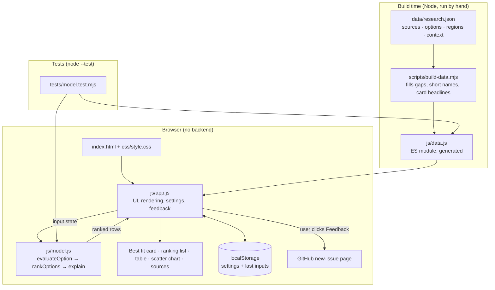

# Energy for AI: System Design

## What it is

A static website: an interactive screening tool that helps an AI data center developer decide where to get power. It ranks eleven supply options for a given load, deadline, US region and set of priorities, and it cites every input figure.

## Architecture

## Components

| Component | Job |
|---|---|
| `data/research.json` | The source of truth: 47 cited sources, 11 options (cost, carbon, years to power, capacity factor, firmness, typical max size, notes, real deals) and 10 US regions (queue time, solar and wind capacity factor, gas price, grid carbon, industrial power price, geothermal and hydro resource). |
| `scripts/build-data.mjs` | Turns the research into `js/data.js`. Fills the hydro gaps (derived ~$73/MWh point estimate; grid-connection timeline), adds short display names and fact-card headlines. |
| `js/model.js` | Pure scoring with no DOM. `evaluateOption` applies regional conditions to one option; `rankOptions` normalises and weights; `explain` writes the plain-English reasons. |
| `js/app.js` | Reads the controls, calls the model, renders everything, handles the tooltip, settings dialog (⌘,), theme, units, persistence and the feedback dialog. |
| `index.html`, `css/style.css` | Layout and styling. Light and dark tokens, and a responsive layout that stacks the controls above the results below 860px. |
| `scripts/serve.py` | Local no-cache dev server. |

## Main flows

**Ranking:** for each control change, `app.js` builds `{loadMW, neededBy, regionId, mustBeFirm, weights}` and calls `rankOptions`:

1. **Per option (`evaluateOption`):**
   - Start from the midpoint of the cited cost and timeline ranges.
   - Grid: use the region's industrial power price and grid carbon.
   - Gas options (engines, combined cycle, fuel cells, hybrid): add `(regional gas price − $2.50) × heat rate`.
   - Solar, wind and hybrid: scale cost by the reference capacity factor over the regional one (clamped).
   - Geothermal and hydro: a *poor* resource makes the option unavailable; *fair* adds 25% to cost and 1 year to the timeline.
   - Grid-queue-bound options (grid, solar, wind, hybrid, hydro): scale the timeline by the regional queue median ÷ the national 4.6-year median, clamped to 0.7–1.3×.
   - Loads bigger than a typical project need N projects, each extra one adding 0.25 yr (capped at 3).
   - Flag a missed deadline (fastest case is too late) or a tight one (typical case is too late).
   - Reliability is `0.6 + 0.4 × capacity factor` for firm options and `0.5 × capacity factor` for variable ones.
2. **Across options (`rankOptions`):**
   - Min-max normalise cost, carbon, years and reliability to 0–1 over the available options, then take the weighted average × 100.
   - Penalties: unavailable → 0, missed deadline ×0.5, tight timeline ×0.85, not firm when 24/7 is required ×0.6.
3. **Render:** best fit card, ranked bars, table, and a scatter of cost against years with the deadline line. The top three are blue; the rest are muted.

**Settings:** the gear button or ⌘/Ctrl+, opens a dialog. Changes apply at once and are saved to `localStorage` (`efa.settings`).

**Feedback:** the dialog builds a GitHub new-issue URL with the text plus the region, load and deadline, and opens it in a new tab. Nothing is sent until the user submits on GitHub.

## Where data lives

- **Reference data:** `data/research.json` (edited by hand), and `js/data.js` generated from it. Both are committed.
- **User state:** browser `localStorage` only (`efa.settings`, `efa.input`), wrapped in try/catch so the site still works with storage blocked. There is no server and no analytics.

## Key decisions and trade-offs

| Decision | Why | Trade-off |
|---|---|---|
| Static site, no framework, no build step for the site | GitHub Pages serves it as-is; nothing to break or upgrade. | Hand-written DOM rendering; fine at this size. |
| Website only, no Mac app | The brief's deliverable is a website; confirmed with the user. | No offline native app. |
| A transparent heuristic model, not optimisation | Developers need to see *why* an option ranks where it does. | Min-max scores are relative to the option set, so adding or removing an option shifts every score. |
| Midpoints of cited ranges | Simple, explainable, and every input is traceable. | Hides the spread; the full ranges are shown in each row's detail. |
| Regional queue medians scale the national range instead of replacing it | The LBNL regional medians measure new *generators*, not load connections (flagged by the research). | Regional grid timelines are approximate. |
| Gas reference of $2.50/MMBtu | Regional prices are 2024 EIA delivered prices (a low-price year); only the regional *difference* is passed through, so Lazard's base costs stay intact. | Doesn't model future gas price moves. |
| Grid "cost" is an industrial retail price | No LCOE exists for buying from the grid. | Excludes demand charges, upgrade contributions and large-load tariffs. |
| Feedback via a pre-filled GitHub issue | A static site has no backend; the user reviews before anything is posted. | Needs a GitHub account. |

## Testing

- `npm test` runs `node --test` on `tests/model.test.mjs`.
  - Model behaviour: cost weighting, deadline penalty, grid regional inputs and queue stretch, gas price pass-through, poor resource exclusion, multi-site sizing, non-firm penalty, explanations.
  - Data integrity: every option has its core fields, every `src` resolves to a source, and every region ranks with finite scores.
- Checked by hand in a browser:
  - The page loads at desktop width and at 375px with no horizontal scroll.
  - Dark mode works, and ⌘, opens settings.
  - Ranking rows expand.
  - There are no console errors.

## Known limits

- **Screening, not feasibility:** no site-specific transmission, permitting, land, water or fuel-supply analysis.
- **Derived and vendor figures (marked DERIVED in the research):**
  - Engine and aero turbine cost, fuel cell cost, SMR low-end cost, gas-option carbon, hybrid carbon and hydro cost are derived estimates.
  - Fuel cell timelines and emissions are vendor claims.
  - Existing-nuclear contract prices aren't public.
- **Regional coverage is uneven:** solar and wind capacity factors exist for six ISOs only, and the Pacific Northwest has no gas price. The model skips the adjustment where data is missing.
- **Existing nuclear often ranks first, but supply is very limited.** Only a few restart or co-location candidates exist; the row notes say so, but the score doesn't model scarcity.
- **No portfolio mix:** options are ranked one at a time, so the tool doesn't build blends such as grid plus on-site bridge power.
- **Overlapping dots:** when two dots fall in the same spot on the chart, only the top one can be hovered; the table view has every value.
- **US-only, as of October 2026.**
